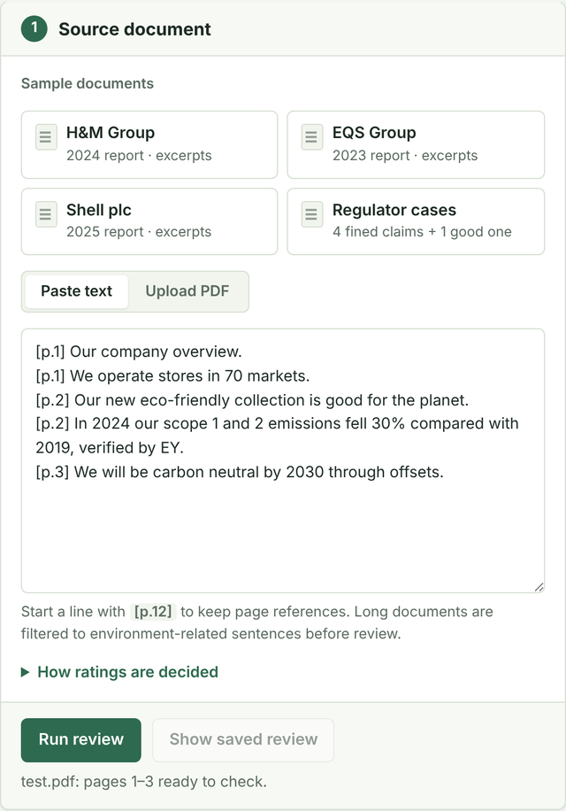
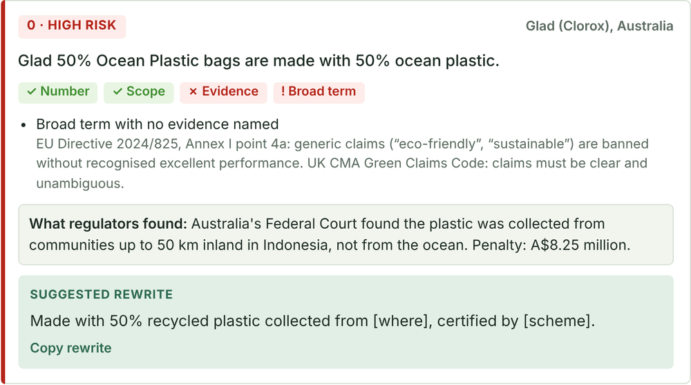
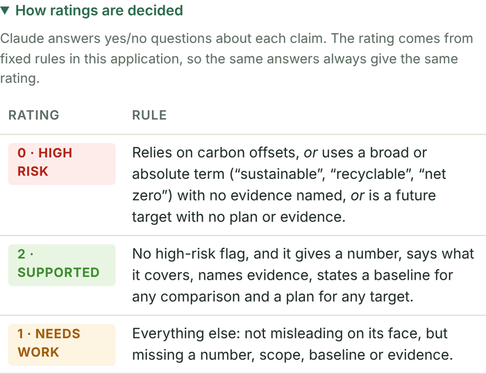

# Tutorial

## 1. Choose the source document

- **Sample documents:** click H&M Group, EQS Group, Shell plc or Regulator cases. Each loads its text and a saved review.
- **Paste text:** replace the text in the box with your own. Start a line with `[p.12]` to keep page references.
- **Upload PDF:** open the Upload PDF tab, optionally enter a page range, then choose or drop a PDF. It is read in the browser, and only environment-related sentences are kept.

Long texts (over about 4,000 characters) are filtered to environment-related sentences. One review covers up to 200 sentences; narrow the page range for long reports.

## 2. Run the review

Press **Run review**. The first time, allow the page to use Claude. Results arrive batch by batch, and **Stop** cancels the review. **Show saved review** returns a sample to its saved result.

## 3. Read the results

- **Summary:** total claims and the count for each rating. Filter with All / High risk / Needs work / Supported.
- **Claim card:** rating, page, the claim word for word, ✓/✗ checks, red flags, reasons with the rule behind each, and a suggested rewrite. Facts the company must add are in `[brackets]`.
- **Regulator cases:** each card also shows what the regulator found.

## 4. How ratings are decided

Open **How ratings are decided** in the Source document panel, or see [SCORING.md](SCORING.md).

## 5. Export

Press **Export results (CSV)** for a spreadsheet of ratings, quotes, reasons, rules and rewrites.

## Troubleshooting

| Message | Fix |
|---|---|
| Live reviews unavailable in this view | Open the published claude.ai version, or use the saved reviews |
| Claude wasn't allowed for this page | Reload and choose Allow |
| Too many requests or usage limit reached | Wait a minute and try fewer pages |
| That text is too long | Choose a smaller page range |
| This PDF couldn't be read | It may be scanned; paste the text instead |
